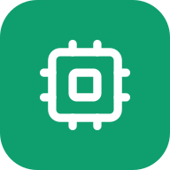
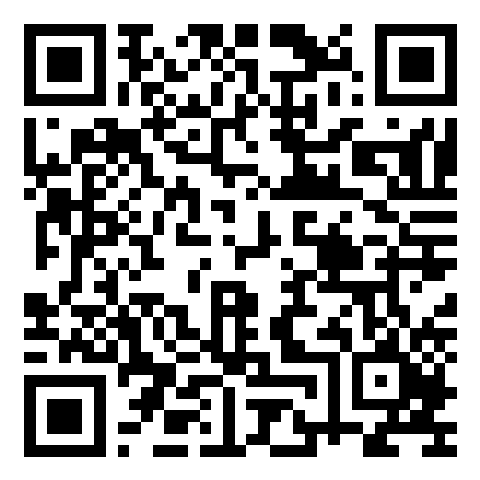

# Kho đồ

App quản lý đồ cá nhân với **3 kho trong một app**: linh kiện điện tử, tủ quần áo và tủ bếp. Mỗi kho có loại, danh mục, vị trí, màu giao diện và trợ lý riêng — brainstorm mạch DIY từ linh kiện sẵn có, phối đồ từ tủ quần áo, gợi ý món ăn từ nguyên liệu trong bếp, và tự thêm món còn thiếu vào danh sách cần mua. Đăng nhập bằng Google, mỗi tài khoản có kho riêng.

- **Dùng ngay, không cần tự cài:** https://inventory.nguyenducquan.io.vn
- **Mã nguồn:** https://github.com/betaplamvan/inventory (tự deploy: xem [Chạy production bằng Docker](#chạy-production-bằng-docker))

**Stack:** Next.js 16 (App Router, Server Actions) · PostgreSQL 17 + Drizzle ORM · MinIO (ảnh / video / datasheet) · Tailwind CSS 4

## Tính năng

- **3 kho, chuyển bằng một chạm** (nút ở menu / thanh trên cùng):
  - **Kho linh kiện** — linh kiện, module, dụng cụ, vật tư; MPN, package, datasheet
  - **Tủ quần áo** — áo, quần, váy, áo khoác, giày dép, phụ kiện; màu, size, chất liệu, mùa, phong cách
  - **Tủ bếp** — rau củ, thịt cá trứng, đồ khô, gia vị…; **hạn sử dụng**, báo sắp hết hạn / đã hết hạn, xếp theo hạn dùng
  - Mỗi kho có danh mục / vị trí tạo sẵn (tủ lạnh, ngăn đá, kệ đồ khô; tủ quần áo, kệ giày…) và màu giao diện riêng (mẫu A "Nhãn dán")
- **Cần mua**: danh sách đi chợ của từng kho; gợi ý từ món dưới mức tối thiểu; đánh dấu đã mua → nhập kho luôn (món có sẵn) hoặc mở form thêm mới điền sẵn; chép danh sách để gửi qua tin nhắn
- **Trợ lý brainstorm** theo kho (LLM tự host + MCP): mạch DIY làm được với linh kiện đang có, phối đồ theo dịp / thời tiết, món ăn từ nguyên liệu (ưu tiên đồ sắp hết hạn) — chỉ rõ món nào đã có, món thiếu thì thêm vào danh sách cần mua

- **Kho hàng**: tìm kiếm tiếng Việt có dấu hoặc không dấu ("tu gom" ra "Tụ gốm"), lọc theo loại / danh mục / vị trí / tình trạng, xem dạng danh sách hoặc lưới, nút **+ / −** chỉnh nhanh số lượng
- **Mặt hàng**: tên, SKU riêng, hãng, MPN, package, bảng thông số tuỳ ý (có gợi ý theo loại), tag, đơn vị (cái/mét/cuộn…, cho phép số lẻ như 0,5 cuộn thiếc), mức tối thiểu, đơn giá, nhà cung cấp, link mua, link datasheet
- **Ảnh / video / tài liệu** lưu trên MinIO: kéo thả để upload, tự tạo thumbnail cho ảnh, xem video tua được, chọn ảnh đại diện, xem toàn màn hình
- **Nhập / Xuất / Kiểm kê**: mỗi lần đổi số lượng đều ghi lịch sử, kèm dự án hoặc nguồn hàng, ghi chú, giá nhập. Không cho xuất quá số đang có
- **Danh mục & vị trí cất** dạng cây nhiều cấp (Tủ A › Ngăn 3). Có nút tạo sẵn bộ danh mục điện tử phổ biến
- **Tổng quan**: tổng số mặt hàng, giá trị kho, danh sách cần mua thêm, các lần nhập/xuất gần đây
- **Nhập / xuất CSV**: xuất theo bộ lọc (mở thẳng bằng Excel), nhập từ file CSV hoặc bảng dán từ Excel / Google Sheets, có xem trước. Xuất → sửa trong Excel → nhập lại để cập nhật hàng loạt
- **Nhãn QR + quét mã**: in nhãn cho mặt hàng và vị trí cất (nhiều cỡ, giấy decal hoặc máy in nhãn). Quét bằng camera trong app hoặc camera thường của điện thoại để mở đúng mặt hàng; quét được cả mã vạch / QR chứa SKU, MPN (nhãn túi LCSC) và mã vị trí
- **Thùng rác**: xoá chỉ chuyển vào thùng rác (giữ ảnh và lịch sử), khôi phục được trong 30 ngày rồi tự xoá hẳn
- **Ghi nguồn thao tác**: mỗi dòng lịch sử ghi rõ đến từ web, agent nào (tên API token / kết nối OAuth) hay nhập file
- **Cảnh báo sắp hết hàng** qua Telegram và / hoặc email, gửi ngay khi số lượng tụt xuống mức tối thiểu
- **Trợ lý chat** dùng LLM tự host (llama.cpp / vLLM / Ollama…): hỏi tồn kho, tìm linh kiện, thêm / nhập / xuất bằng lời; thao tác thay đổi dữ liệu luôn chờ bấm xác nhận. Lịch sử lưu theo tài khoản, mở được trên mọi thiết bị
- **Cài như app (PWA)**: thêm vào màn hình chính, có lối tắt Quét mã / Thêm mặt hàng, nút chụp ảnh thẳng bằng camera
- **Đăng nhập bằng Google (OAuth)**, mỗi tài khoản có kho riêng. App không lưu mật khẩu (xem mục bên dưới)
- Giao diện có bản cho điện thoại và chế độ tối, chủ đề vàng đen (logo tủ ngăn kéo, font Be Vietnam Pro). File đi qua Next nên chỉ cần mở **1 cổng** là điện thoại trong mạng LAN dùng được

## Đăng nhập bằng Google

Thiết kế:

- **Luồng OAuth:** Authorization Code + PKCE (S256), xử lý hoàn toàn trên server. `state` và `code_verifier` lưu trong cookie httpOnly 10 phút.
- **Kiểm tra `id_token`:** xác minh chữ ký bằng JWKS của Google (RS256), kiểm tra `aud` và `iss`, bắt buộc `email_verified`.
- **Tài khoản:** bảng `users` cùng `auth_identities` (provider + Google `sub`). Lần đăng nhập đầu tiên thì tạo user; nếu đã có user trùng email thì liên kết vào user đó.
- **Phiên:** cookie httpOnly chứa token ngẫu nhiên, DB chỉ lưu SHA-256 của token. Phiên kéo dài 30 ngày và tự gia hạn khi dùng. Có "đăng xuất thiết bị khác" và xoá tài khoản.
- **Tách dữ liệu:** mọi truy vấn, Server Action và API đều lọc theo tài khoản đang đăng nhập.
- **Dữ liệu cũ:** dữ liệu tạo trước khi có tài khoản được gán cho tài khoản đầu tiên đăng nhập.

### Tạo Google OAuth Client

1. Vào https://console.cloud.google.com/apis/credentials (tạo project nếu chưa có).
2. Mở **OAuth consent screen**, chọn *External* và điền tên app cùng email. Trong lúc thử, thêm Gmail của bạn vào *Test users*.
3. Vào **Credentials → Create credentials → OAuth client ID** và chọn loại **Web application**:
   - *Authorized JavaScript origins:* `http://localhost:3000`
   - *Authorized redirect URIs:* `http://localhost:3000/api/auth/google/callback`
4. Chép **Client ID** và **Client secret** vào `.env` (`GOOGLE_CLIENT_ID`, `GOOGLE_CLIENT_SECRET`), rồi khởi động lại server.

> **Lưu ý:** Google chỉ chấp nhận redirect URI dạng `http://` cho `localhost`. Muốn đăng nhập từ máy khác hoặc điện thoại, app phải có
> **tên miền chạy HTTPS** (Cloudflare Tunnel, Tailscale Funnel, reverse proxy…). Khi đó:
>
> - đặt `APP_BASE_URL=https://ten-mien-cua-ban` và `COOKIE_SECURE=true`;
> - thêm `https://ten-mien-cua-ban/api/auth/google/callback` vào danh sách redirect URI trên Google.

Khi phát triển, có thể đặt `ALLOW_DEV_LOGIN=true` để hiện ô "đăng nhập thử" bằng email bất kỳ, không qua Google.
Ô này **tự tắt khi chạy production**.

## Chạy khi phát triển

Cần có: Node.js 20+ và Docker.

```bash
cp .env.example .env          # rồi sửa mật khẩu nếu muốn
npm install
npm run services:up           # khởi động Postgres (cổng 5433) + MinIO (9000, console 9001)
npm run dev                   # http://localhost:3000
npm run db:seed -- ban@gmail.com   # (tuỳ chọn) thêm dữ liệu mẫu cho tài khoản (đăng nhập 1 lần trước)
```

Khi server khởi động sẽ **tự chạy migration** và **tự tạo bucket MinIO**.

## Chạy production bằng Docker

```bash
cp .env.example .env          # điền GOOGLE_CLIENT_ID/SECRET, APP_BASE_URL, MINIO_SECRET_KEY…
docker compose --profile app up -d --build
```

Mở `http://<ip-máy>:3000`. Dữ liệu nằm trong 2 volume Docker là `pgdata` và `miniodata`.

## Cảnh báo sắp hết hàng

Áp dụng cho mặt hàng có đặt **mức tối thiểu**: khi số lượng tụt xuống mức đó (hoặc về 0) thì gửi tin ngay, dù thay đổi đến từ web, agent hay nhập file. Cùng một cảnh báo không lặp lại trong 10 phút.

Quản trị bật kênh bằng biến môi trường (xem `.env.example`), sau đó mỗi người tự bật ở **Tài khoản → Thông báo sắp hết hàng**:

- **Telegram:** tạo bot bằng [@BotFather](https://t.me/BotFather), đặt `TELEGRAM_BOT_TOKEN`. Người dùng bấm *Kết nối Telegram* → mở chat với bot → *Start*. App chỉ gọi ra `api.telegram.org` (không cần webhook hay mở cổng). Đừng đặt webhook cho bot này, vì app đọc tin bằng `getUpdates`.
- **Email:** đặt `SMTP_HOST`, `SMTP_PORT`, `SMTP_USER`, `SMTP_PASS`, `SMTP_FROM`. Thư gửi tới email Google của tài khoản.

## Nhãn QR và quét mã

- **In nhãn:** nút *In nhãn* ở trang mặt hàng, danh sách kho (in theo bộ lọc đang chọn) và trang Vị trí cất. Chọn cỡ 40×25 / 50×30 / 70×40 mm rồi in (lề tối thiểu, tỉ lệ 100%).
- QR chứa link ngắn `<APP_BASE_URL>/s/i/<id>` (mặt hàng) hoặc `/s/l/<id>` (vị trí): quét bằng camera thường cũng mở đúng trang, chưa đăng nhập thì qua trang đăng nhập trước.
- **Quét trong app** (`/scan`, nút trên đầu trang ở điện thoại): dùng `BarcodeDetector` nếu trình duyệt hỗ trợ (đọc cả mã vạch 1D), không thì dùng jsQR (chỉ QR). Camera cần app chạy qua HTTPS.
- Mã không phải nhãn của app: khớp SKU / MPN (không phân biệt hoa thường) → mở mặt hàng; khớp mã vị trí → danh sách hàng ở đó; còn lại → tìm trong kho.

## Nhập từ CSV / Excel

Trang **Nhập từ file** (`/import`): chọn file `.csv` hoặc dán thẳng bảng copy từ Excel / Google Sheets.

- Dòng đầu là tiêu đề, tên cột giống file xuất (có dấu hay không đều được). Tải *File mẫu* để xem.
- Dòng có `ID` hoặc `SKU` trùng mặt hàng đang có thì **cập nhật** (ô trống = giữ nguyên; số lượng đổi được ghi là kiểm kê), còn lại **thêm mới**. Có thể chọn bỏ qua dòng trùng.
- Danh mục / vị trí ghi dạng `Tụ điện > Tụ gốm`, có tuỳ chọn tự tạo mục chưa có.
- Luôn **xem trước** trước khi ghi; dòng lỗi không chặn các dòng khác. Tối đa 2000 dòng mỗi lần.

## MCP cho AI agent

App có sẵn **MCP server** (Streamable HTTP) tại `<APP_BASE_URL>/api/mcp`. Claude Code, Claude Desktop, Cursor… dùng nó để đọc và thêm dữ liệu vào kho.

### Kết nối bằng OAuth (Claude web / điện thoại, không cần token)

1. Trên claude.ai: **Settings → Connectors → Add custom connector**, dán `https://kho.example.com/api/mcp`.
2. Claude mở trang đăng nhập Google của app → chọn quyền (*đọc + ghi* / *chỉ đọc*) → **Cho phép**.
3. Connector tự có trên app điện thoại cùng tài khoản. Kết nối hiện trong **Tài khoản → API token** (nhãn OAuth), thu hồi ở đó.

Claude Code cũng dùng được OAuth: `claude mcp add --transport http kho-do https://kho.example.com/api/mcp` rồi gõ `/mcp` để đăng nhập.

Chi tiết kỹ thuật: theo đặc tả MCP Authorization — metadata ở `/.well-known/oauth-protected-resource` và `/.well-known/oauth-authorization-server`, đăng ký client động `/api/oauth/register`, trang đồng ý `/oauth/authorize` (bắt buộc PKCE S256), token `/api/oauth/token`. Access token sống 1 giờ, refresh token 90 ngày (xoay vòng mỗi lần dùng).

### Kết nối bằng API token

1. Vào **Tài khoản → API token cho AI agent** và tạo token:
   - quyền *đọc + ghi* hoặc *chỉ đọc*;
   - có thời hạn;
   - token chỉ hiện một lần;
   - mỗi token chỉ thấy kho của người tạo.
2. Chép lệnh cấu hình hiện ngay dưới token. Với Claude Code:

   ```bash
   claude mcp add --transport http kho-do https://kho.example.com/api/mcp      --header "Authorization: Bearer inv_…"
   ```

| Tool | Việc |
|---|---|
| `inventory_overview` | Tổng quan một kho hoặc cả 3 kho: số mặt hàng, giá trị, cần mua thêm, sắp hết hạn, giao dịch gần đây |
| `inventory_snapshot` | Danh sách gọn mọi thứ đang có trong một kho (1 dòng / món: số lượng, đặc điểm, hạn dùng, vị trí) — để brainstorm mạch / phối đồ / món ăn |
| `list_shopping_list`, `add_shopping_items`, `update_shopping_item` | Danh sách cần mua của từng kho: xem, thêm nhiều món, đánh dấu đã mua (nhập kho luôn), sửa / xoá |
| `search_items` | Tìm / lọc mặt hàng (không phân biệt dấu), theo danh mục, vị trí, loại, tình trạng |
| `get_item` | Chi tiết mặt hàng, thông số, link, ảnh/tài liệu, lịch sử |
| `get_item_images` | Trả ảnh (thumbnail) để agent xem trực tiếp, kèm URL xem có thời hạn của từng ảnh để hiển thị ngay trong câu trả lời chat (xem dưới) |
| `list_categories`, `list_locations`, `list_movements` | Cây danh mục / vị trí, lịch sử nhập xuất |
| `create_item`, `update_item` | Thêm / sửa mặt hàng. Danh mục và vị trí truyền bằng tên, ví dụ `"Tụ điện > Tụ gốm"`; `createMissing` để tự tạo |
| `import_items` | Thêm / cập nhật tới 100 mặt hàng một lần (đơn hàng, bảng kê), khớp theo id / SKU, có `dryRun` để xem trước |
| `record_movement` | Nhập / xuất / kiểm kê, có ghi lịch sử, không cho xuất quá số đang có |
| `delete_item`, `list_trash`, `restore_item` | Chuyển vào thùng rác / xem / khôi phục |
| `create_category`, `create_location` | Tạo danh mục / vị trí |
| `create_upload_url` | Xin link upload ngắn hạn cho 1 mặt hàng; agent `curl` file thẳng lên (xem dưới) |

Mọi tool có tham số `domain`: `electronics` (linh kiện), `wardrobe` (quần áo), `pantry` (thực phẩm). Tool đọc không truyền `domain` thì xem cả 3 kho; tool ghi không truyền thì mặc định `electronics` (tương thích agent cũ). Thực phẩm có thêm `expiresAt` (YYYY-MM-DD) và lọc `stock: "expiring" | "expired"`.

Agent chỉ xoá được vào thùng rác; **xoá hẳn** chỉ làm được trên giao diện web. Token *chỉ đọc* bị chặn mọi tool ghi. Mọi thay đổi số lượng do agent thực hiện đều ghi kèm tên token / kết nối trong lịch sử.

### Gắn ảnh / file

Nội dung file **không** đi qua MCP (model phải chép lại từng ký tự base64, rất tốn token). Thay vào đó agent gọi `create_upload_url` để lấy link upload rồi POST file thẳng lên:

```bash
curl -sS -X POST "https://kho.example.com/api/media/upload?t=up_…&filename=hop-nhua.jpg" \
  --data-binary @photos/hop-nhua.jpg
```

- Link chỉ upload được vào đúng 1 mặt hàng, mặc định hết hạn sau 15 phút (tối đa 60) và nhận tối đa 10 file (tối đa 50).
- Thu hồi API token thì link tạo từ token đó cũng mất hiệu lực.
- Loại file đoán theo đuôi `filename` nếu không gửi `Content-Type`. Nhận ảnh, video, PDF.
- Ảnh đầu tiên tự thành ảnh đại diện; thêm `&cover=1` để đổi.

Script cũng có thể upload bằng API token quyền ghi: `POST /api/media/upload?itemId=<id>&filename=<tên>` kèm header `Authorization: Bearer inv_…`.

### Hiển thị ảnh trong câu trả lời

Trình chat (Claude web / điện thoại…) không có cookie đăng nhập của app nên không tải được `/api/media/<id>`. `get_item_images` vì thế trả kèm cho mỗi ảnh một `thumbnailUrl`, `url` (ảnh gốc) và sẵn một đoạn `markdown` để agent chèn vào câu trả lời:

```
https://kho.example.com/api/media/42?thumb=1&t=ml_…
```

- Link được bảo vệ bằng token bí mật ngẫu nhiên trong URL (DB chỉ lưu SHA-256): chỉ **xem**, chỉ **ảnh** của đúng 1 mặt hàng (không mở được video / PDF), hết hạn sau 30 ngày (hoặc sớm hơn nếu API token hết hạn trước). Hết hạn thì ảnh trong đoạn chat cũ không hiện lại nữa.
- Ai giữ URL thì xem được trong thời hạn đó (giống presigned URL), vì trình chat không gửi được cookie đăng nhập kèm ảnh.
- Thu hồi API token / kết nối thì link tạo từ đó cũng mất hiệu lực.

## Trợ lý chat (LLM tự host)

Trang **Trợ lý** (`/chat`) và nút nổi ở góc màn hình mở khung chat với một LLM bạn tự host. Trợ lý dùng **đúng bộ tool MCP** ở trên (chạy ngay trong app, không qua mạng), nên làm được mọi việc như Claude qua MCP: tìm, xem, thống kê, thêm / sửa, nhập / xuất / kiểm kê, nhập nhiều dòng, chuyển vào thùng rác và khôi phục.

- Tool **đọc** chạy ngay. Tool **ghi** hiện thẻ *Xác nhận / Bỏ qua* (kèm tên mặt hàng và tham số); chỉ chạy khi bấm Xác nhận. Lịch sử nhập / xuất ghi nguồn `agent: Trợ lý chat`.
- Mỗi cuộc trò chuyện thuộc kho đang chọn lúc bắt đầu: trợ lý nhận vai trò riêng (bạn đồng hành DIY / stylist / đầu bếp gia đình), tool mặc định làm việc với kho đó, câu gợi ý theo kho. Trang Trợ lý chỉ liệt kê cuộc trò chuyện của kho đang chọn.
- Nhiều thao tác chờ xác nhận cùng lúc → nút **Xác nhận tất cả / Bỏ qua tất cả**.
- Lịch sử chat lưu trong DB theo tài khoản (bảng `chat_conversations`, `chat_messages`).
- Câu trả lời **chạy nền trên server**, không phụ thuộc kết nối trình duyệt: chuyển trang, đóng khung chat, khoá màn hình điện thoại hay mở trên thiết bị khác đều xem tiếp được (client tự nối lại qua `GET /api/chat/conversations/[id]/stream`). Chỉ dừng khi bấm nút Dừng (`POST /api/chat/stop`) hoặc sau 10 phút.
- Cần server có API kiểu OpenAI hỗ trợ **gọi tool** (function calling), ví dụ `llama-server --jinja` với Qwen 2.5 / Qwen 3. Khối `<think>` của model suy luận được ẩn đi.

Cấu hình (bỏ trống `LLM_BASE_URL` = tắt trợ lý, ẩn nút nổi):

```bash
LLM_BASE_URL=https://llm.example.com   # có hoặc không có /v1
LLM_API_KEY=…                          # gửi dạng Authorization: Bearer
LLM_MODEL=                             # bỏ trống = model đầu tiên của /v1/models
```

Khi deploy: `LLM_API_KEY` là secret, `LLM_BASE_URL` / `LLM_MODEL` là variable (đã có trong `deploy/sync-secrets.sh`).

### Tra web (tuỳ chọn)

Đặt `SEARCH_URL` trỏ tới một [SearXNG](https://docs.searxng.org/) tự host thì trợ lý có thêm `web_search` (tìm) và `read_webpage` (đọc trang) — tra datasheet / sơ đồ chân, công thức món ăn, mẹo phối đồ, giá bán… và ghi nguồn bằng link. Tool chỉ đọc nên chạy ngay, tối đa 8 lần tra mỗi lượt; `read_webpage` chặn mọi địa chỉ nội bộ (localhost, LAN, Tailscale…). Cấu hình và cách chạy SearXNG: [deploy/searxng/](deploy/searxng/README.md). Khi dev: `docker compose --profile search up -d searxng` rồi `SEARCH_URL=http://localhost:8888`.

## CI/CD

Push lên `main` sẽ build image (GHCR) rồi tự deploy lên máy chủ riêng (self-hosted runner) qua GitHub Actions.
Xem [deploy/README.md](deploy/README.md).

## Ủng hộ tác giả

Kho đồ miễn phí và mã nguồn mở. Nếu app có ích cho bạn, dù dùng bản có sẵn hay tự deploy, có thể mời tác giả một ly cà phê hoặc tặng repo một sao. Cảm ơn bạn!



| | |
|---|---|
| Ngân hàng | MB Bank |
| Số tài khoản | `0941672663` |
| Chủ tài khoản | NGUYEN DUC QUAN |
| Nội dung | `UNG HO KHO LINH KIEN` |

Quét mã bằng app ngân hàng bất kỳ (VietQR), số tiền tuỳ bạn. Trong app, trang **Ủng hộ tác giả** (link nhỏ trong menu tài khoản) có cùng thông tin kèm mã QR điền sẵn số tiền; trang này hiện trên mọi bản deploy. Thông tin nằm trong [`src/lib/author.ts`](src/lib/author.ts); sửa file đó thì chạy `npx tsx scripts/gen-support-qr.ts` để tạo lại ảnh QR ở đây.

## Lệnh hữu ích

| Lệnh | Tác dụng |
|---|---|
| `npm run db:generate` | Tạo migration sau khi sửa `src/db/schema.ts` |
| `npm run db:migrate` | Áp dụng migration (thường không cần, vì server tự chạy khi khởi động) |
| `npm run db:studio` | Mở Drizzle Studio để xem và sửa DB |
| `npm run typecheck` | Kiểm tra TypeScript |
| `node scripts/gen-icons.mjs` | Tạo lại icon app và favicon từ logo (sau khi sửa logo) |
| `docker compose down -v` | **Xoá sạch** DB và file (mất toàn bộ dữ liệu) |

## Ghi chú về MinIO

MinIO đã ngừng phát hành image Docker bản community (`minio/minio` không còn trên Docker Hub). Project này dùng
[`pgsty/minio`](https://hub.docker.com/r/pgsty/minio), một bản fork do cộng đồng duy trì, tương thích hoàn toàn.
Muốn đổi image thì đặt biến `MINIO_IMAGE` trong `.env`.

Console MinIO: http://localhost:9001 (đăng nhập bằng `MINIO_ACCESS_KEY` / `MINIO_SECRET_KEY`).

## Cấu trúc

```
src/
  app/(app)/          các trang: tổng quan, kho hàng, chi tiết, nhập/xuất, danh mục, vị trí
  app/api/media/      upload (stream lên MinIO) và đọc file (hỗ trợ Range cho video)
  app/api/export/     xuất CSV (+ file mẫu nhập)
  app/s/              link ngắn trên nhãn QR
  actions/            Server Actions (thêm/sửa/xoá, nhập/xuất, danh mục…)
  db/schema.ts        schema Drizzle
  lib/queries.ts      truy vấn dữ liệu
  lib/storage.ts      MinIO client
  lib/auth/           Google OAuth (PKCE + JWKS), phiên đăng nhập, liên kết tài khoản
  app/api/auth/       /google (bắt đầu), /google/callback, /dev-login
  app/api/mcp/        MCP server (Streamable HTTP, Bearer token)
  lib/mcp/server.ts   định nghĩa các tool MCP
  lib/domains.ts      cấu hình 3 kho (tên, loại, đơn vị, thông số gợi ý, danh mục mẫu, vai trò trợ lý)
  lib/inventory/shopping.ts  danh sách cần mua
  components/domain.tsx      nút chuyển kho, đồng bộ cookie inv_domain + màu giao diện (html[data-domain])
  lib/chat/           trợ lý chat: client LLM (API kiểu OpenAI), vòng lặp gọi tool, lưu hội thoại
  app/api/chat/       stream câu trả lời (SSE), danh sách / xoá cuộc trò chuyện
  components/chat/    khung chat, trang /chat, nút nổi
  lib/inventory/      nghiệp vụ ghi dữ liệu dùng chung cho web và MCP (thùng rác, nhập CSV…)
  lib/notify/         cảnh báo sắp hết hàng (Telegram, email)
  proxy.ts            chuyển về /login khi chưa có cookie phiên
drizzle/              file migration SQL
scripts/seed.ts       dữ liệu mẫu
```

## Giấy phép

[MIT](LICENSE): tự do dùng, sửa, tự deploy, kể cả dùng thương mại, chỉ cần giữ lại thông báo bản quyền.
